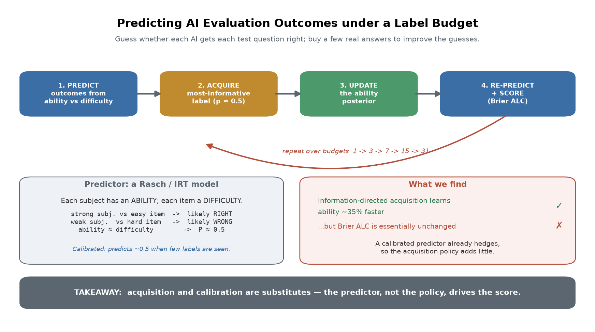

# Measurement-Theoretic Active Elicitation for Predicting AI Evaluation Outcomes

Predicting whether an AI system answers a benchmark item correctly, under a
strict budget on how many ground-truth labels may be purchased, framed as a
measurement problem: the correctness probability is a Rasch interaction between a
subject's latent **ability** and an item's **difficulty**, and choosing which
labels to buy is efficient, Fisher-information-guided **elicitation** (adaptive
testing). Developed for the NeurIPS 2026 Predictive AI Evaluation Competition and
written up as the CS329H final project.



## Contributions

- A **Bayesian IRT predictor**: `sigmoid(theta_s - beta_i)` with a MAP/Laplace
  posterior over subject ability, updated online as labels arrive — calibrated
  uncertainty where a black-box tabular predictor has none.
- Four **acquisition policies** — random, uncertainty `|p-0.5|`, Fisher `p(1-p)`,
  and a novel **expected-Brier-reduction** policy over the frozen evaluation pool.
- An **offline replay harness** scored by **Brier ALC** with bootstrap CIs.

## Headline finding

Information-directed acquisition pins down ability markedly faster than random
selection, but this **barely moves Brier ALC**: once the predictor is calibrated
it already hedges under a wide posterior, so the acquisition policy adds little.
**Acquisition cleverness and predictor calibration are substitutes** — the
predictor, not the policy, drives the score.

## Repository layout

```
code/                 experiment code (see code/README.md for setup + reproduce)
  src/                irt.py, acquisition.py, replay.py, data.py
  run_experiments.py  runs everything, writes results/ figures + tables
  make_explainer.py   regenerates the overview figure
manuscript/           NeurIPS-format report (main.tex, main.pdf, references.bib)
pre_analysis_plan/    the approved pre-analysis plan (main.tex, main.pdf)
```

## Quickstart

```bash
cd code
pip install -r requirements.txt
python run_experiments.py      # ~30s, CPU-only; writes results/
```

See [`code/README.md`](code/README.md) for details, data notes, and the leakage
boundary. All randomness is seeded.

## Related work by the author

- *How Many Items Do You Really Need? IRT-Based Redundancy Analysis of LLM
  Benchmarks* (CS321M, 2026).
- *Beyond Accuracy on RelBench: Item Response Theory Analysis of Relational Deep
  Learning Benchmarks* (ICML 2026 Workshop on Graph Foundation Models).
- *Are Tabular Foundation Model Rankings Reliable? A Generalizability Theory
  Analysis of RelBench and DBInfer* (2nd ICML Workshop on Foundation Models for
  Structured Data, 2026).
